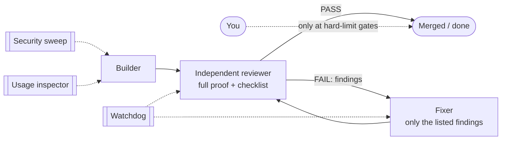

# Autonomous Delivery for Claude Code

**Run long work almost hands-off.** One role builds, an independent gate reviews, a fixer fixes, and monitors watch security, quality and cost. You act only at the gates you choose, such as a production deploy.

It works for software, docs and courses, data and analytics, infrastructure, migrations and research. It runs on your machine, or around the clock as Claude Code cloud routines fired by GitHub.



## Install

In Claude Code:

```
/plugin marketplace add Mgabr90/autonomous-delivery
/plugin install autodeliver@autonomous-delivery
```

Or from a shell:

```
claude plugin marketplace add Mgabr90/autonomous-delivery
claude plugin install autodeliver@autonomous-delivery
```

## Use

| Command | What it does |
|---|---|
| `/autodeliver:init [local\|cloud] [profile]` | Sets up the project: config, charter docs, agents. In cloud mode, also routines, webhooks and a loop test. |
| `/autodeliver:loop <task>` | Runs the local loop on one task (build, review, fix) until PASS or the round cap. |
| `/autodeliver:status` | Reports phases, PRs and verdicts, open items, gates waiting for you, and routine runs. |
| `/autodeliver:doctor [--fix]` | Checks the setup and repairs what it safely can. |

**Quick start (local, 2 minutes):**

```
/autodeliver:init local software
/autodeliver:loop "add input validation to the signup form"
```

**Quick start (cloud):**
1. Connect the repo at [claude.ai/code](https://claude.ai/code) and create an environment.
2. Run `/autodeliver:init cloud`. It creates five routines and their webhooks, then opens a setup PR as the loop test.
3. From then on, phases run on their own. `/autodeliver:status` shows where things are.

## What you get

- **An independent review gate.** It runs the full proof itself before any PASS. It classifies findings as Blocking, Should-fix or Nit, and PASS requires zero Blocking and zero Should-fix. It also checks plan completeness, fail-safe behaviour when services are absent, flaky tests, missing translations and missing evidence.
- **A closed fix loop.** A label fires the fixer, the fixer's push re-fires the review, and the gate merges on PASS. A watchdog catches stalls and takes over stuck PRs.
- **No dependency on you:**
  - visual checks: Playwright screenshots plus a visual-review agent;
  - translations: a review agent;
  - policy questions: logged rulings;
  - owner facts: derived, or worded so they're true without them.

  You act only at hard-limit gates, each prepared as a single action.
- **A weekly security sweep** of the whole main branch. Serious findings are confirmed at runtime.
- **A daily usage inspector.** It ranks waste with evidence and proposes exact edits under a quality-first rule.
- **A staging gate template** for safe cloud access to staging: HTTPS, per-client token hashes, allow-listed verbs, read-only SQL, and isolated rehearsals of irreversible steps.

## Profiles

| Profile | Proof the reviewer runs | Typical gate |
|---|---|---|
| software | tests, typechecks, lint, build, e2e | production deploy |
| docs | validators, link check, render, style lint | publication |
| data | reproducible run, data tests, reconciliation | production data write |
| infra | plan or dry run, policy checks, staging apply | production apply |
| migration | golden tests vs. the source, parity matrix | cutover |
| research | citations reachable, claims traced | decision sign-off |

You can mix profiles or define your own in `.autodeliver/config.json`.

## Learn more

- [The playbook](plugins/autodeliver/skills/autonomous-delivery/references/playbook.md): principles, roles, every flowchart and the lessons learned.
- [Profiles](plugins/autodeliver/skills/autonomous-delivery/references/profiles.md), [config reference](plugins/autodeliver/skills/autonomous-delivery/references/config.md), [cloud setup](plugins/autodeliver/skills/autonomous-delivery/references/cloud-setup.md), [staging gate](plugins/autodeliver/skills/autonomous-delivery/templates/staging/README.md).

## Requirements

- Claude Code 2.1 or later.
- Cloud mode also needs a GitHub repo with the Claude GitHub app, a claude.ai/code environment, and the `gh` CLI.
- The token log (on by default; `"token_log": false` turns it off) needs Python 3.

Plugins don't load in cloud sessions, so `init` copies the agents into your repo's `.claude/agents/`.

**Context cost:** about 1K tokens of always-on context per session (skill and agent descriptions). The full instructions load only when a command or agent runs.

## Maintainers

[@Mgabr90](https://github.com/Mgabr90) and [@Ahmed0623](https://github.com/Ahmed0623). Contributions are welcome; see [CONTRIBUTING.md](CONTRIBUTING.md).

## License

[MIT](LICENSE)
