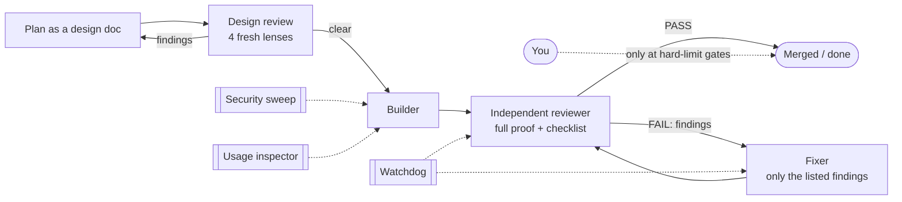

# Autonomous Delivery for Claude Code

**Run long work almost hands-off.** One role plans and builds, fresh-eyes reviewers check each plan before anything is built, an independent gate reviews the result, a fixer fixes, and monitors watch security, drift, quality and cost. You act only at the gates you choose, such as a production deploy.

It works for software, docs and courses, data and analytics, infrastructure, migrations and research. It runs on your machine, or around the clock as Claude Code cloud routines fired by GitHub or Azure DevOps.



## Install

In Claude Code:

```
/plugin marketplace add Mgabr90/autonomous-delivery
/plugin install autodeliver@autonomous-delivery
```

Or from a shell:

```
claude plugin marketplace add Mgabr90/autonomous-delivery
claude plugin install autodeliver@autonomous-delivery
```

## See it run

[**autodeliver-demo**](https://github.com/Mgabr90/autodeliver-demo) is one real phase on a small Python service: the plan as a design doc, four fresh-eyes design reviewers, a test-first build and the independent gate, with every verdict committed as the agents wrote it. The design review caught all three defects planted in the starting code before any code was written, and the gate passed in round 1. It is one small phase, not a benchmark.

## Try it in one minute (no setup)

In any repo, after installing:

```
/autodeliver:review                     # an independent gate on your current changes: runs your tests itself, PASS or FAIL
/autodeliver:design-review docs/plan.md # four fresh-eyes reviewers on a plan or spec, before you build
```

When you want the whole loop, run `/autodeliver:init`.

## Use

| Command | What it does |
|---|---|
| `/autodeliver:init [local\|cloud] [profile]` | Sets up the project: config, charter docs, agents. In cloud mode, also routines, webhooks and a loop test. |
| `/autodeliver:loop <task>` | Runs the local loop on one task (build, review, fix) until PASS or the round cap. |
| `/autodeliver:status` | Reports phases, PRs and verdicts, open items, gates waiting for you, and routine runs. |
| `/autodeliver:doctor [--fix]` | Checks the setup and repairs what it safely can. |
| `/autodeliver:review [scope] [--fix] [--comment]` | One-shot independent gate on your changes, a branch, a PR or files. No setup needed. |
| `/autodeliver:design-review <doc>` | Fresh-eyes review of any plan, spec or RFC by four isolated reviewers. No setup needed. |
| `/autodeliver:report` | Tokens per role and round, rounds to PASS, findings per round. |

**Quick start (local, 2 minutes):**

```
/autodeliver:init local software
/autodeliver:loop "add input validation to the signup form"
```

**Quick start (cloud):**
1. Connect the repo at [claude.ai/code](https://claude.ai/code) and create an environment.
2. Run `/autodeliver:init cloud`. It creates five routines and their webhooks (or, on Azure DevOps, prepares the service hooks), then opens a setup PR as the loop test.
3. From then on, phases run on their own. `/autodeliver:status` shows where things are.

## What you get

- **A design review before anything is built.** Each phase plan is a design doc: design, decisions, the exact files it will touch, and a test plan. Four fresh reviewers check it in parallel without ever seeing the planner's reasoning: is it the simplest design that fits the codebase, can a newcomer follow it, will it hold up, and can it be built without guessing? The planner resolves their findings itself, so nothing waits for you. The idea comes from Google's [Elephant-Goldfish Model](https://github.com/google/elephant-goldfish-model): design with an elephant, review with a goldfish.
- **An independent review gate.** It runs the full proof itself before any PASS. It classifies findings as Blocking, Should-fix or Nit, and PASS requires zero Blocking and zero Should-fix. It also checks plan completeness, that the work stays inside the plan's file boundary and follows its design, fail-safe behaviour when services are absent, flaky tests, missing translations and missing evidence.
- **A closed fix loop.** A label fires the fixer, the fixer's push re-fires the review, and the gate merges on PASS. A watchdog catches stalls and takes over stuck PRs.
- **No dependency on you:**
  - visual checks: Playwright screenshots plus a visual-review agent;
  - translations: a review agent;
  - policy questions: logged rulings;
  - owner facts: derived, or worded so they're true without them.

  You act only at hard-limit gates, each prepared as a single action.
- **A researcher agent** that writes a sourced brief before each phase and fact-checks docs and PRs. Every claim carries a URL, date and quote, or is marked unverified.
- **A weekly security sweep** of the whole main branch. Serious findings are confirmed at runtime. The same sweep checks a living system doc against the code and reports drift.
- **Stop guards.** A loop that stops making progress (the same finding three times, or no fewer open findings across two rounds) stops and re-plans instead of burning tokens. An optional token budget caps a local loop.
- **An optional second opinion** from another vendor's model, with every item verified by the gate.
- **A daily usage inspector.** It ranks waste with evidence and proposes exact edits under a quality-first rule.
- **A staging gate template** for safe cloud access to staging: HTTPS, per-client token hashes, allow-listed verbs, read-only SQL, and isolated rehearsals of irreversible steps.

## Profiles

| Profile | Proof the reviewer runs | Typical gate |
|---|---|---|
| software | tests, typechecks, lint, build, e2e | production deploy |
| docs | validators, link check, render, style lint | publication |
| data | reproducible run, data tests, reconciliation | production data write |
| infra | plan or dry run, policy checks, staging apply | production apply |
| migration | golden tests vs. the source, parity matrix | cutover |
| research | citations reachable, claims traced | decision sign-off |

You can mix profiles or define your own in `.autodeliver/config.json`.

## Learn more

- [The playbook](plugins/autodeliver/skills/autonomous-delivery/references/playbook.md): principles, roles, every flowchart and the lessons learned.
- [Profiles](plugins/autodeliver/skills/autonomous-delivery/references/profiles.md), [config reference](plugins/autodeliver/skills/autonomous-delivery/references/config.md), [cloud setup](plugins/autodeliver/skills/autonomous-delivery/references/cloud-setup.md), [staging gate](plugins/autodeliver/skills/autonomous-delivery/templates/staging/README.md).

## Requirements

- Claude Code 2.1 or later.
- Cloud mode also needs a claude.ai/code environment, and either a GitHub repo with the Claude GitHub app and the `gh` CLI, or an Azure DevOps repo with a PAT (see [cloud setup](plugins/autodeliver/skills/autonomous-delivery/references/cloud-setup.md)).
- The token log (on by default; `"token_log": false` turns it off) needs Python 3.

Plugins don't load in cloud sessions, so `init` copies the agents into your repo's `.claude/agents/`.

**Context cost:** about 1K tokens of always-on context per session (skill and agent descriptions). The full instructions load only when a command or agent runs.

## Community

- **Questions, ideas and show-and-tell:** [Discussions](https://github.com/Mgabr90/autonomous-delivery/discussions).
- **Easy first contributions:** a new [profile](https://github.com/Mgabr90/autonomous-delivery/issues/new?template=new_profile.yml), a [lesson learned](https://github.com/Mgabr90/autonomous-delivery/issues/new?template=lesson_learned.yml), an example config for your stack, or a translation of the playbook. See the [`good first issue`](https://github.com/Mgabr90/autonomous-delivery/labels/good%20first%20issue) label.
- **Every PR is validated by CI**, and contributors are credited in the CHANGELOG.

## Maintainers

[@Mgabr90](https://github.com/Mgabr90) and [@Ahmed0623](https://github.com/Ahmed0623). Contributions are welcome; see [CONTRIBUTING.md](CONTRIBUTING.md).

## Credits

The design review is adapted from Google's [Elephant-Goldfish Model](https://github.com/google/elephant-goldfish-model) by Jim Quinn, Elise Ewing and Dave Rensin (Apache 2.0; licence in `plugins/autodeliver/licenses/EGM-LICENSE.txt`), after Dave Rensin's essay [Elephants, Goldfish, and the New Golden Age of Software Engineering](https://medium.com/@drensin/elephants-goldfish-and-the-new-golden-age-of-software-engineering-c33641a48874).

## License

[MIT](LICENSE). `plugins/autodeliver/agents/design-reviewer.md` is a modified work under Apache 2.0.
