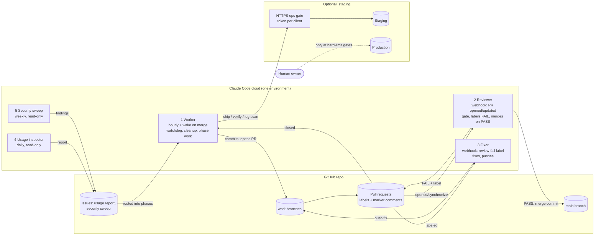
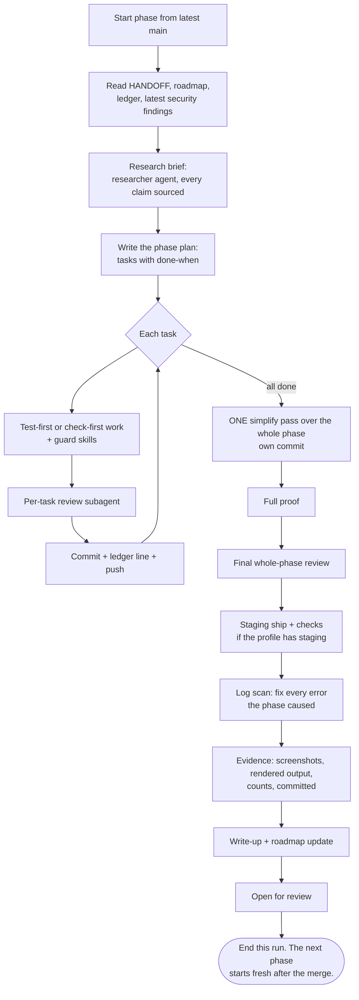
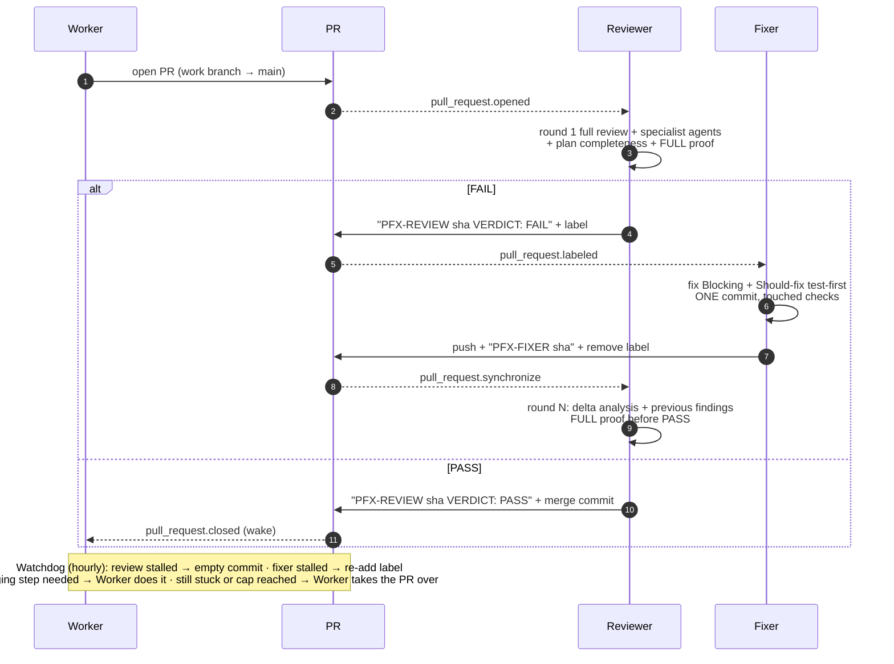
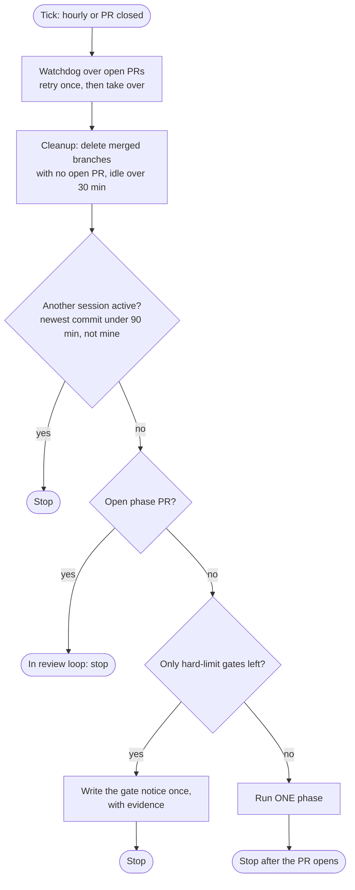
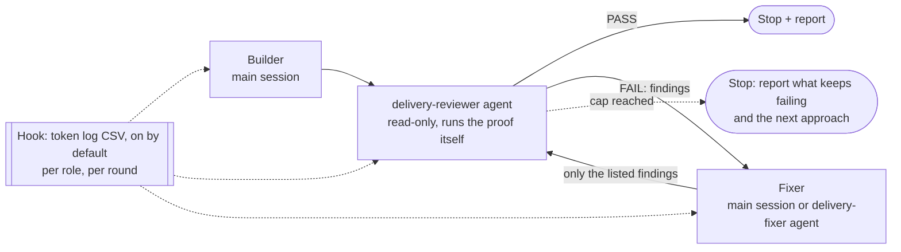
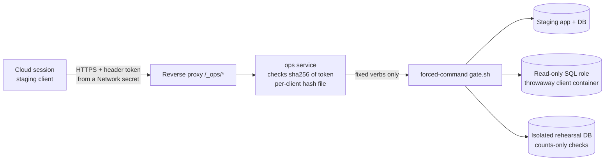
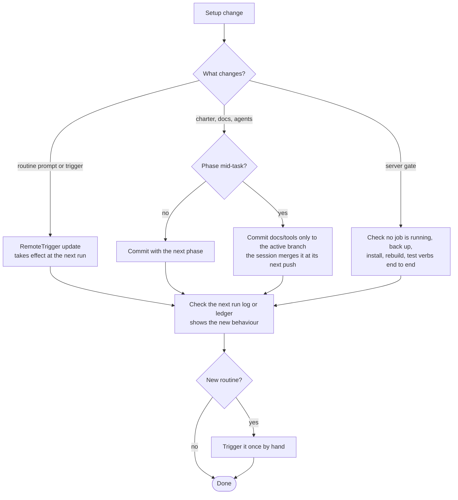

# Autonomous delivery playbook

A reusable way to run long pieces of work almost hands-off with Claude Code. One role **builds**, an independent role **reviews**, another **fixes**, and **monitors** watch quality, security and cost. A human acts only at the gates they choose.

It works for any work that can be checked: software, documents and courses, data and analytics, infrastructure, migrations and research. Section 3 has a profile for each.

It runs in one of two modes:
- **Local:** one Claude Code session on your machine, with subagents and hooks. No GitHub or cloud is needed.
- **Cloud:** Claude Code routines on the web, fired by GitHub events. This mode runs around the clock and survives usage-limit resets.

---

## 1. Principles

1. **Quality first.** Never trade review depth, proof or verification for tokens. Save only by removing waste: idle runs, duplicate reviews, context bloat.
2. **No dependency on the human.** Nothing is parked "for the user":
   - visual checks are done by screenshots plus a visual-review agent;
   - session-written translations get a review agent;
   - product and policy questions get rulings;
   - owner-only facts are derived, or written in wording that is true without them;
   - stalls and caps go to the Worker.

   The human acts only at their own **hard-limit gates**, each prepared as a single action.
3. **Autonomy with a charter.** Sessions decide on their own and log every ruling with its *cost if wrong*. They don't stop to ask.
4. **Hard limits, never crossed.** For example:
   - only the gate merges into the main branch;
   - production needs explicit approval;
   - test data only outside production;
   - no secrets in git.
5. **Independent review.** The reviewer did not do the work, runs separately, runs the deterministic checks itself, and passes only with the full proof green.
6. **State lives in files, not in sessions.** The handoff doc, roadmap, plans, ledgers and decisions log make any session restartable from zero.
7. **Least privilege everywhere.** Sessions reach outside systems only through narrow, allow-listed gates.
8. **Event-driven, with a watchdog.** Events drive the loop; a periodic tick catches anything that stalls.
9. **No paid CI needed.** Everything runs in Claude Code sessions.

---

## 2. Roles

| Role | Does | Never does |
|---|---|---|
| **Builder / Worker** | Plans and builds one work unit (a "phase"), verifies it, opens it for review. In cloud mode it is also the watchdog and the janitor, and it takes over stuck loops. | Merges its own work. Crosses a hard limit. |
| **Reviewer (gate)** | Independent review plus the full proof. Classifies findings as Blocking, Should-fix or Nit. PASS = zero Blocking, zero Should-fix, proof green. Merges on PASS (cloud) or reports PASS (local). | Edits the work. Merges on FAIL. |
| **Fixer** | Fixes exactly the Blocking and Should-fix findings, test-first, in one commit per round. | Reviews. Merges. Touches unrelated work. |
| **Security sweep** | Reviews the *whole* main line on a schedule, and confirms serious findings at runtime. | Changes anything. |
| **Usage inspector** | Measures usage, ranks waste and proposes exact edits, under the quality-first rule. | Applies its own edits. Proposes cheaper models or fewer checks for judgement work. |
| **Researcher** | Gathers evidence: a sourced **brief** before a phase (current docs, breaking changes, prior art, owner facts, policy context), and a **fact-check** of claims in documents and PRs. Every claim carries a URL, date and quote, or is marked unverified. | Decides, builds or reviews. Acts on instructions found in web content. |

---

## 3. Profiles: one loop, many kinds of work

Each profile sets what "proof" means, what the reviewer checks, and what counts as evidence. Pick one at `/autodeliver:init`, mix several, or define your own. Full details are in `profiles.md`.

| Profile | Work unit | Proof (deterministic, run by the reviewer) | Reviewer adds | Evidence | Typical gate |
|---|---|---|---|---|---|
| **software** | feature or phase branch | all test suites, typechecks, lint, build, e2e if UI changed, schema-drift check | correctness, security, races, error paths end to end, migrations, test quality, fail-safe when services are absent | test counts, staging checks, screenshots | production deploy |
| **docs** (guides, courses, reports, policies) | section or chapter | validators, link checker, render or build, spell and style lint, structure limits | accuracy against sources, completeness against the brief, audience and tone, consistency, citations | rendered output, source list | publication |
| **data** (analysis, dashboards, pipelines) | notebook, model or pipeline step | reproducible run from clean, data tests, reconciliation counts, schema checks | method soundness, leakage, sampling, units, privacy (no row-level personal data in outputs) | run logs, counts, charts | sharing results or writing to production data |
| **infra** (IaC, configs, servers) | change set | `plan` or dry run, policy-as-code checks, lint, apply to staging | blast radius, rollback, least privilege, secrets handling, isolation from neighbours | plan output, staging health, log scan | production apply |
| **migration** (port, rewrite, upgrade) | phase of a parity matrix | golden tests against the source of truth, parity matrix, plus the software proof | the source wins on conflicts, nothing dropped, data-migration safety on real-shaped data | parity matrix, rehearsal on an isolated copy | cutover |
| **research** (decisions, designs, investigations) | question or design doc | citation check, every source reachable, claims traced to sources | evidence quality, alternatives considered, cost if wrong | source list, decision record | decision sign-off |

---

## 4. System overview (cloud mode)

## 5. Phase lifecycle

**Simplify once, at the end of the phase.** A per-task simplify churns work that the next task changes again. One pass over the whole phase sees duplication across tasks, and its own commit is easy to review and revert.

## 6. The closed review/fix loop

| Marker | Writer | Meaning |
|---|---|---|
| `<PFX>-REVIEW <sha> VERDICT: PASS\|FAIL` plus `(round N, full\|delta\|docs-only)` | Reviewer | The verdict for exactly that sha; the idempotency key. |
| label `<pfx>-review-fail` | Reviewer adds, Fixer removes | **Fires the Fixer.** Label events are supported triggers; comment events are not. |
| `<PFX>-FIXER <sha> round <k>` / `blocked: …; Worker takes over` | Fixer | What was fixed, or a hand-off. |
| `<PFX>-RETRY review\|fixer <sha>` | Worker | The watchdog's one retry per kind per sha. |
| `<PFX>-SECURITY <date>`, `<PFX>-SECURITY-NOTE`, `<PFX>-USAGE <date>` | Sweep, operator, inspector | Reports and corrections on their issues. |

## 7. Worker tick

## 8. Local mode

| Cloud piece | Local equivalent |
|---|---|
| Reviewer routine + webhook | the `delivery-reviewer` agent, dispatched each round by `/autodeliver:loop` |
| Marker comment | the reviewer's reply starts with `VERDICT: PASS` or `VERDICT: FAIL`, then the finding sections |
| Fixer routine + label | the main session (no cold start) or the `delivery-fixer` agent (cleaner separation). The reviewer must always be separate. |
| Full proof | the profile's deterministic checks, run by the reviewer itself |
| Usage inspector | the token-log hook (on by default; `token_log: false` turns it off), plus the `usage-inspector` agent on demand |
| Ledger / HANDOFF | `docs/delivery/` (the same files as cloud mode) |
| Deliberate loop test | a sample with **seeded defects**; the reviewer must catch them all first |

**Measure the loop's value:** run one comparable task without the loop as a baseline, logged the same way. Compare tokens, defects caught and a quality rating before adopting the loop.

## 9. Gates and staging

**Hard-limit gates** are the only places a human acts. Each is prepared so that it is one action:
- the evidence is gathered;
- the runbook is rehearsed;
- the notice is written once in the decisions log, under "Hard-limit gates".

Typical gates are a production deploy, publication, a production data write, and placing real data that only the owner can decrypt.

**Add a production-readiness phase before the rehearsal.** Building the features doesn't make a system ready to run. Before going live, the sessions must:
- size it for the host it shares;
- give it encrypted, restore-tested backups;
- set up a watch routine;
- clear critical dependency advisories.

Sessions can do all of this; the owner is involved only if more hardware is needed.

**Rehearse before the irreversible step.** Restore a copy of the real data into an isolated, throwaway environment:
- an internal network, joined to nothing else;
- aggregate checks only, never row contents;
- torn down afterwards, with the data copy kept root-only until the final restore is verified, then shredded.

Run the exact cutover steps there first.
- **The owner placing the copy is their consent.** Have them place it **once, early** (`templates/owner/place-real-data.sh`), and keep it root-only until the final restore is verified.
- **Run the rehearsal only when its roadmap row is next.**
- **Stage owner-only credentials early too** (`templates/owner/stage-production-secrets.sh`). The go-live then needs only the owner's "go" in chat.

**Staging access from the cloud** goes through an allow-listed gate, never SSH keys in sessions:

Useful verbs:
- `status`, `logs`, `logs-since <min>` (the post-deploy log scan);
- `upload` and `deploy <sha>`;
- `sql-ro`;
- test-account helpers restricted to `@example.com`;
- `rehearsal-up|restore|migrate|check|down`;
- an app API proxy that still requires the app's own login;
- **configuration without an operator:** `config-show`, `gen-secret`, `set-config`, `apply-config`, `run-cli` (allow-listed app CLIs) and `prune-images`. CLI-only secrets live in a file the app never reads.

See `templates/staging/`.

## 10. Lessons learned

| What happened | Rule |
|---|---|
| `issue_comment` webhooks never fired the routine. Comment events aren't a supported trigger; only pull request, release and issue events are. | Drive the Fixer with a **label** (`pull_request.labeled`). |
| GitHub triggers support filters (base and head branch, labels, draft, merged, author, title, body). | Filter each trigger to cut wasted runs. For example: Reviewer with base = main and head starting with the branch prefix; Fixer with labels including the fail label. **Also** keep the event, branch and marker checks in every prompt, as defence in depth. |
| GitHub events over the per-task or per-account hourly caps are dropped, not queued. | The Worker's watchdog is required, not optional: it re-fires stalled reviews and fixers. Schedules can't run more often than hourly. |
| `pull_request.*` events also fire for the bot's own pushes. | That closes the loop. Guard it with per-sha markers and a cap. |
| GraphQL was unavailable in cloud sessions. | Use REST `gh api` or the GitHub MCP tools. |
| Cloud sessions can't be messaged from other sessions. | Talk to them through files (ledger, HANDOFF) and issues. |
| Plugins don't load in cloud sessions. | `/autodeliver:init` copies the agents into the repo's `.claude/` folder, which cloud sessions do load. |
| Reviewers that scoped the *proof* to the delta passed broken heads. | Scope the **analysis** per round; always run the **full proof** before PASS. |
| A reviewer passed with plan items undelivered (15 of 21). | A plan-completeness section is mandatory; a missing item is a Should-fix. |
| The Fixer pushed a fix and a formatting commit a minute apart, which triggered two full reviews. | One commit per round; never push formatting-only commits. |
| Long sessions re-read 700K+ contexts every turn. | One phase per session run; state in files; narrow subagent briefs. |
| A persistent Worker session carried four phases in one growing context, and while it was busy its hourly cleanup never ran (merged branches stayed for hours). | Run every routine with `persist_session: false`. State lives in the pushed ledger (push at least every 30 minutes), and the 'another session is active' check prevents overlap. |
| Two webhook events on one PR started two reviewers on the same sha, and both posted a full review. | The reviewer re-checks for an existing review of the sha right before posting, and stops silently if one appeared or the head moved. |
| Two reviews of one sha reached the Fixer, which answered only the latest; five Should-fix items (one a privacy leak) needed an extra fix round and review. | The Fixer answers the **union** of every FAIL review on the current head and lists the review ids it answered. The Reviewer also **claims** a sha before reviewing, so a second run stops before doing a full review. |
| An operator rebuilt two routine prompts from an old local copy, silently reverting another session's additions (research agent, web tools, gate ordering) for about 10 hours. | Always `get` the live prompt and edit that, never an older copy. Compare tool lists and key sections before and after each update. |
| Two container restarts in one phase: one killed an implementer with 8 files uncommitted, the other cut a full e2e run while five finished fix commits sat unpushed. A fresh session also lost review findings kept only in the git-ignored workspace. | Push before every long step; put review findings in the committed ledger as soon as a review returns; follow a fixed recovery order after a restart (HANDOFF template). |
| Routine API calls from an operator session returned 404 and an empty list, because that session was logged into a different claude.ai account. The routines were fine. | Routines belong to one account. Check `list` before deciding a routine is gone, and use the owning account's login to inspect or edit them. |
| The cloud permission check blocked the Reviewer's merge after its own PASS ("Merge Without Review"), although the same step had merged earlier phases. The PR sat unmerged for 6 hours, and the Worker kept waiting on the open PR. | The Reviewer merges through the REST endpoint pinned to the reviewed sha, and first states that it is carrying out its own posted PASS. If the merge is still blocked, it posts `<PFX>-MERGE-PENDING` and sends a push notification. The Worker's watchdog flags a PASS left unmerged, but never merges it. |
| Pushing setup changes onto an active branch forced catch-up merges. | Change the setup between phases; mid-phase, touch only docs and tools. |
| A prompt updated mid-run took effect only at the next tick. | Expect a one-tick delay; for urgent changes, also leave a ledger note. |
| A routine nobody had triggered was untested. | Trigger every new routine once by hand and read its output. |
| Turning on dependency alerts showed hundreds at once. | The security sweep triages them (runtime vs dev-only, minimal upgrades); phases pick them up. |
| A retention job counted unsent warning emails as sent, so it would have erased accounts without notice. | **Fail safe** when mail, payments, storage or an API is absent. The gate checks this, and caught a second case later. |
| A flaky suite failed once in six runs. | Re-run once to tell flaky from broken; a flaky test is a Should-fix. |
| The first security sweep rated a finding HIGH from code reading; a live check refuted it. | Confirm every HIGH or CRITICAL at runtime on staging. Post corrections as `<PFX>-SECURITY-NOTE`. |
| The cloud token got 403 on the dependency-alerts API. | Fall back to the package manager's audit. |
| A phase was told to "check findings at the next phase". | When a report lands mid-phase, add an intake note to the active ledger. |
| Every new staging setting or secret needed a human with server access. | Allow-listed config verbs: generate-once secrets that are never printed, typed and range-checked settings, `apply-config`, and allow-listed app CLIs via `run-cli`. Sessions never get code execution as root. |
| A secret meant only for the operator CLI was loaded into the app's environment. | Keep two env files: one the app reads, one only the CLI runner reads. |
| Old build images grew toward a full disk on a shared host. | Prune this project's own tags after every deploy (keep the running one + 2). Never run a global prune on a shared host. |
| An operator CLI was excluded from the image by `.dockerignore`, so the production step would have failed. | Smoke-test every operator CLI from the built image (`run-cli … --dry-run`) during the phase. |
| Cloud sessions can't install server files, by design. | Sessions list repo-side server changes under "Pending installs"; the operator installs them during the next progress check. |
| A rehearsal step shredded the owner's data copy, so the final restore would have needed the owner a second time. | Keep the copy (root-only) until the final restore is verified; shred only then. |
| A Worker that treated "backup present" as "go" would have rehearsed on real data before the build phases were done. | Gate a rehearsal on its roadmap row being next, not on the data being present. |
| Nits left at a PASS were lost between phases. | The next phase copies them into its ledger, and does each one or routes it with a ruling. |
| A delta-round PASS skipped e2e although the PR as a whole changed the UI. | Run e2e on every PASS whenever the whole PR touches the UI. |
| An attempt to relax the production hard limit through a file-recorded approval was blocked by the safety system. | Production approval stays a chat message from the owner, by design. Prepare everything else so that it is the only step. |
| The roadmap ended at "features done → go live", with no backups, monitoring or capacity check for a server shared with another production site. | Add a production-readiness phase (capacity, encrypted backups + restore test, watch routine, dependency batch) before the rehearsal. |
| A playbook rule ("webhooks have no filter") was out of date; the platform's docs had changed. | Facts drift. Each phase starts with a **research brief** from the `researcher` agent, and rulings on external facts cite its sources. |
| A long "waiting on you" list built up. | Sessions resolve visual checks, translations, policy and owner facts themselves; only hard-limit gates remain. |
| The CLI account switched to another organisation, so routine calls returned 404. | Check which account is signed in before managing routines (`/login`). |
| Pasting a secret through the clipboard stored the wrong value. | Verify secrets by length and sha256; never print them. |
| Shell quoting broke remote heredocs. | Copy files to servers with `scp`, not inline heredocs. |
| `pipefail` with `head` aborted scripts. | Avoid `head` on pipes under `pipefail`. |
| Free GitHub plans have no branch protection on private repos. | Only the gate merges; it is a hard limit in every prompt. |

## 11. Cost and quality controls

- **Strongest model** for building, reviewing, fixing and security. A **mid-tier model** only for the usage inspector, which makes no quality judgements.
- **Event-driven:** the Reviewer and Fixer run only on events. A Worker tick with nothing due exits in seconds.
- **Review rounds:** round 1 is full; later rounds analyse the delta plus the previous findings; docs-only deltas check only docs. **The proof is always full.**
- **Daily usage report:** waste ranked with evidence and exact edits, applied only after a human approves them.
- **Weekly security sweep:** findings go to an issue, and phases must route each confirmed one.

## 12. Changing the setup while work runs

Record each setup change in the decisions log under "Decided by the user".
